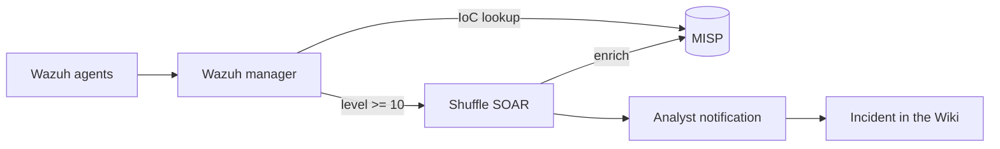

# Security Operations Center

> Monitoring, threat intelligence and incident response for ACME. Live status is on the **[SOC Dashboard](PORTAL_URL)** and the **[SOC Status](/soc/status)** page, both refreshed automatically.
{.is-info}

## Quick access
- [SOC Dashboard *Live view of agents, alerts, threat intel and automation*](PORTAL_URL)
- [SOC Status *Auto-generated status page, updated every 5 minutes*](/soc/status)
- [Wazuh *SIEM / XDR — agents, alerts, vulnerabilities*](https://WAZUH_HOST)
- [MISP *Threat intelligence — IoCs, events, feeds*](https://HOST_IP:8443)
- [Shuffle *SOAR — playbooks and automations*](http://HOST_IP:3001)
{.links-list}

## Knowledge base
- [Monitoring *How we operate Wazuh*](/soc/monitoring)
- [Threat intelligence *MISP sources and trust criteria*](/soc/threat-intel)
- [Automation *Shuffle playbooks and approval rules*](/soc/automation)
- [Incident management *Register, escalation and reporting*](/soc/incidents)
- [Runbooks *Step-by-step response procedures*](/soc/runbooks)
- [Contacts & on-call *Who to call and when*](/soc/contacts)
{.grid-list}

## Detection and response flow

## Severity matrix
| Wazuh level | Severity | Response time | Action |
|---|---|---|---|
| 13–15 | Critical | 15 min | Escalate to on-call and security lead |
| 10–12 | High | 1 h | Tier 2 analyst, open an incident |
| 7–9 | Medium | 8 h | Review during the shift |
| 0–6 | Low | Weekly | Tune rules |
